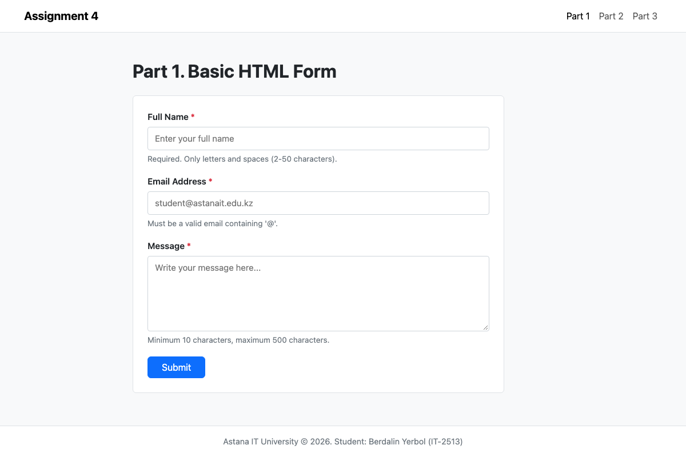
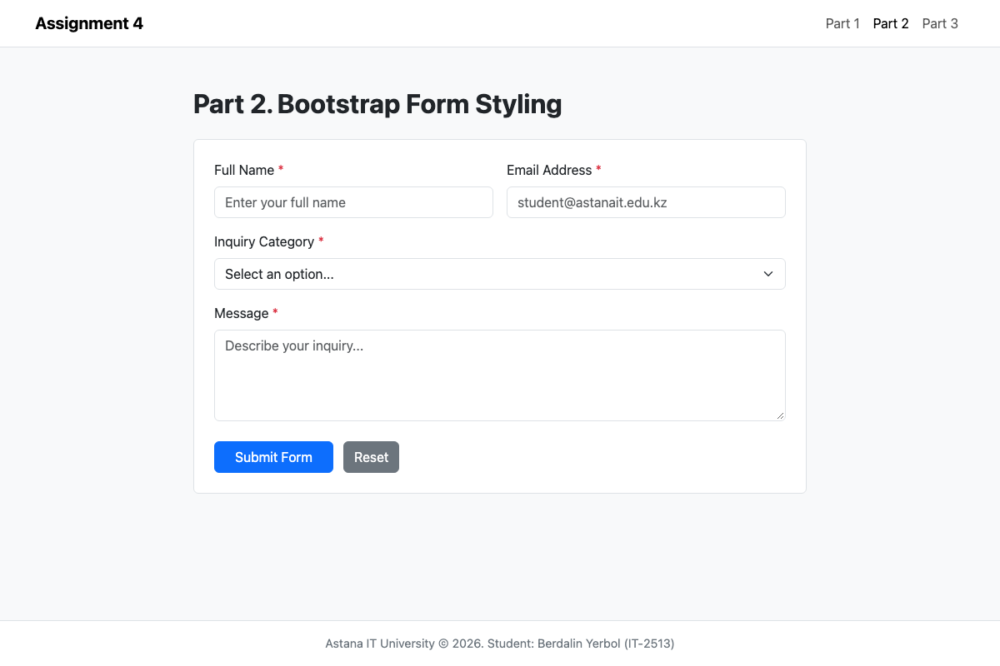
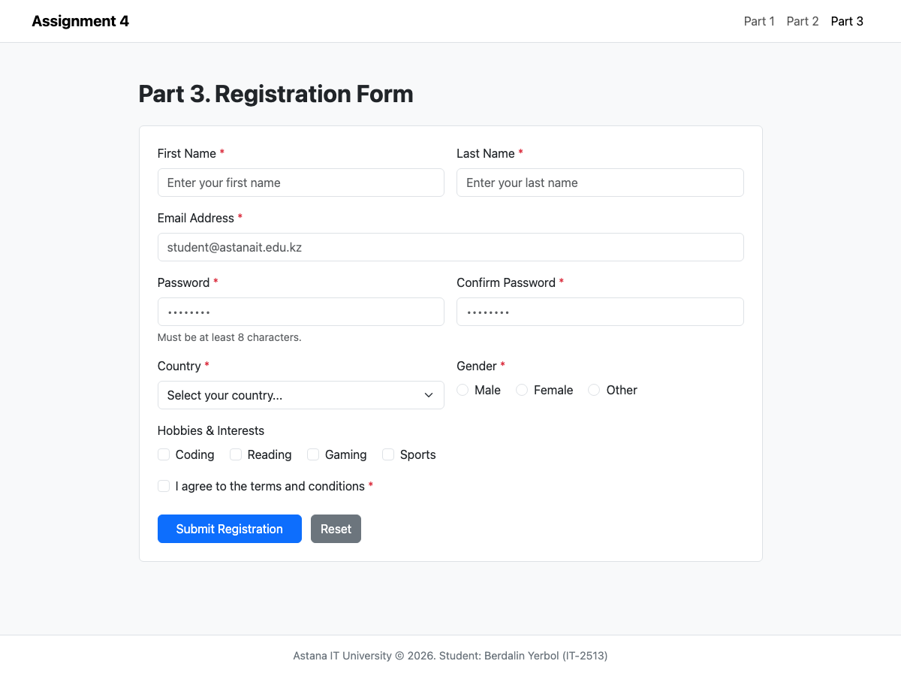

# Assignment #4: Forms and Validation

**Astana IT University**  
**Course:** Web Technologies 1 (Front-End Development)  
**Student:** Berdalin Yerbol  
**Group:** IT-2513  
**Repository:** Public GitHub Repository  

---

## 📌 Project Overview
The objective of this assignment is to understand and implement user-friendly web forms using semantic HTML5 and Bootstrap 5 form components. The project covers client-side constraint validation using native browser attributes (HTML5) as well as custom Bootstrap validation feedback classes with JavaScript handlers.

---

## 📁 Repository Structure
```text
Assignment4_Frontend/
├── index.html          # Part 1: Basic HTML Forms (Tasks 0 & 1)
├── part2.html          # Part 2: Bootstrap Form Styling & Validation (Tasks 2 & 3)
├── part3.html          # Part 3: Advanced Registration Project (Task 4)
├── css/
│   └── style.css       # Clean, readable custom styling
├── js/
│   └── validation.js   # Client-side validation & password match logic
├── screenshots/        # Task demonstration screenshots
└── README.md           # Assignment report and documentation
```

---

## 🚀 Tasks Breakdown & Implementation

### Part 1. Basic HTML Forms

#### Task 0: Simple Contact Form
* **Implementation:** Built semantic contact form with `Name`, `Email`, `Message` (textarea), and a Submit button.
* **Accessibility:** Used explicit `<label for="...">` matching input `id` attributes for standard accessibility and label focus.

#### Task 1: Form with HTML5 Validation
* **Implementation:** Applied native HTML5 validation constraints:
  * `required`: Prevents submission of empty fields.
  * `type="email"`: Enforces standard email syntax.
  * `pattern="^[A-Za-z\s]{2,50}$"`: Restricts name to alphabetic characters (2 to 50 characters).
  * `minlength="10"` & `maxlength="500"`: Ensures appropriate message length.
  * Live character counter tracks message length in real time.

> **Screenshot — Task 0 & 1: Contact Form & HTML5 Validation:**  
> 

---

### Part 2. Bootstrap Forms

#### Task 2: Bootstrap Form Styling
* **Implementation:** Re-created contact form using Bootstrap 5 components:
  * `form-control`, `form-select`, and `form-label` for modern styling and consistent input heights.
  * Responsive grid layout using `row`, `col-md-6`, and `col-12`.
  * Helper hints using `form-text`.

#### Task 3: Bootstrap Validation Styles
* **Implementation:** Applied Bootstrap validation classes:
  * `.is-valid` for successfully verified inputs (green feedback).
  * `.is-invalid` for incorrect inputs (red feedback).
  * `.valid-feedback` and `.invalid-feedback` contextual message blocks.

> **Screenshot — Task 2 & 3: Bootstrap Form Styling & Validation States:**  
> 

---

### Part 3. Advanced Form Project

#### Task 4: Registration Form
* **Implementation:** Developed an advanced registration form featuring:
  * **Personal Information:** First Name, Last Name, Email.
  * **Account Security:** Password and Confirm Password with minimum 8-character length.
  * **Password Toggle:** Show/Hide password toggle button.
  * **Dynamic Password Matching:** Custom JavaScript in `js/validation.js` using `setCustomValidity()` to verify password equality before submission.
  * **Profile Preferences:** Gender (`radio` buttons), Hobbies (`checkbox` elements), Country dropdown (`select`), and Terms & Conditions agreement (`checkbox`).
  * **Responsive Grid:** Two-column responsive layout with Bootstrap (`row g-4`, `col-lg-6`).

> **Screenshot — Task 4: Advanced Registration Form:**  
> 

---

## 🛠️ Work Process Summary
1. **Semantic HTML5:** Built structured forms in `part1.html` verifying native browser constraint enforcement.
2. **Bootstrap Integration:** Recreated form in `part2.html` utilizing Bootstrap components and contextual validation feedback.
3. **Advanced Project:** Implemented registration in `part3.html` with real-time password verification and interactive controls.
4. **Code Quality:** All styling and scripts are cleanly structured in `css/style.css` and `js/validation.js` with comprehensive comments and zero bloat.

---

## 👨‍💻 Author
* **Name:** Berdalin Yerbol
* **Group:** IT-2513
* **University:** Astana IT University (2026)
